# Sign Language → Smart-Glasses HUD

A person signs **Indian Sign Language (ISL)** in front of the wearer. A camera captures the signer, the
**laptop** recognises each sign, and sends the word over **Wi-Fi**. An **ESP32-C3** on the glasses shows the
text on a **0.96" SSD1306 OLED**, which you see floating in front of your eye through a lens and a 45° acrylic
sheet (a DIY head-up display).

Final-year semester project (combined CS + ECE).


<!-- PHOTO: assembled glasses being worn, text visible in the HUD -->

---

## Contents
1. [How it works](#how-it-works)
2. [Status](#status)
3. [Hardware](#hardware)
4. [3D-printed enclosure](#3d-printed-enclosure)
5. [Engineering drawings](#engineering-drawings)
6. [Setup, step by step](#setup-step-by-step)
7. [App ↔ glasses interface](#app--glasses-interface)
8. [Configuration](#configuration)
9. [Troubleshooting](#troubleshooting)
10. [Repository layout](#repository-layout)
11. [Further guides](#further-guides)
12. [Credits](#credits)

---

## How it works

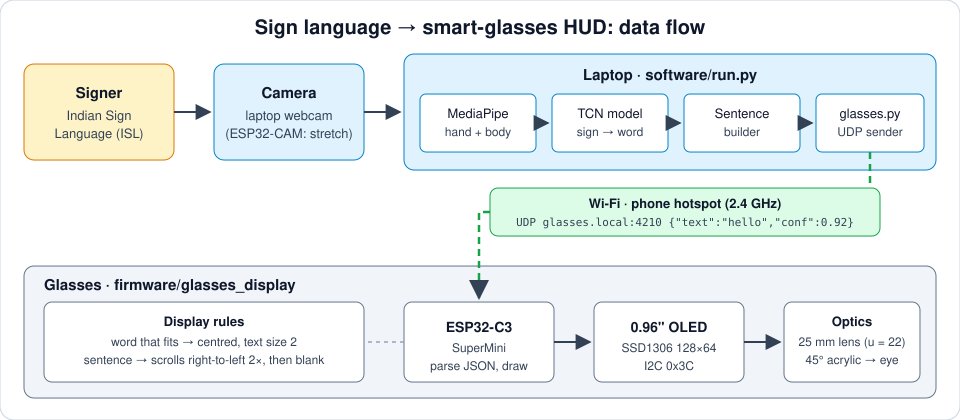

1. **Camera:** the laptop webcam films the signer (an ESP32-CAM on the glasses is a stretch goal).
2. **Recognizer** (`software/run.py`): MediaPipe extracts hand and body landmarks, a TCN model turns them
   into words, and a sentence builder joins the words into a sentence.
3. **Sender** (`software/glasses.py`): every word, and then the finished sentence, goes to the glasses as one
   UDP JSON packet: `{"text": "hello", "conf": 0.92}` → `glasses.local:4210`.
4. **Glasses** (`firmware/glasses_display`): the ESP32-C3 joins the phone hotspot and registers the mDNS name
   `glasses.local`. It shows a short word big in the centre of the OLED. Longer text (a sentence) scrolls
   right-to-left on one line twice, then the screen goes blank.
5. **Optics:** OLED (screen down) → **22 mm** → 25 mm lens → **25 mm** → 45° clear acrylic → eye.
   The text appears as a magnified virtual image in front of the wearer.

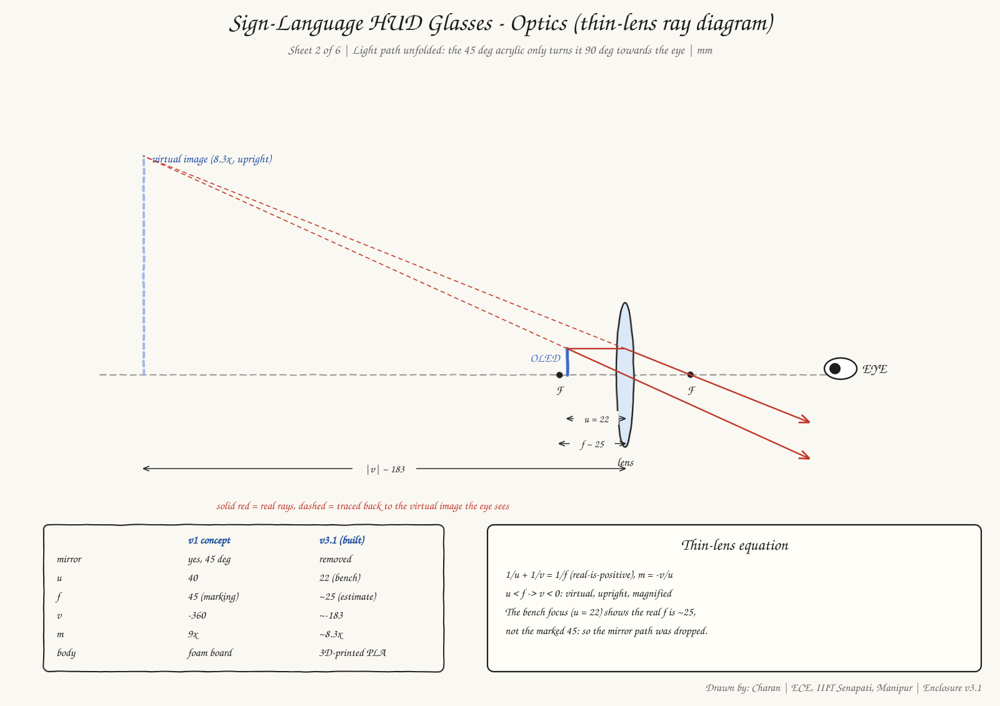

<!-- PHOTO: OLED showing a word on the bench (breadboard setup) -->

## Status

| Part | State |
|---|---|
| Hardware bring-up, Steps 1–11 (board, OLED, Wi-Fi/UDP, TP4056, LiPo, battery power) | ✅ done (2026-10-31) |
| Glasses firmware: Wi-Fi, mDNS, UDP 4210, boot screens, centred words, scrolling sentence, `MIRROR_X`/`FLIP_Y` | ✅ done |
| Recognizer app sends every word + sentence to the glasses (`run.py`, `--simulate` works without a camera) | ✅ done |
| Enclosure v3.1 (OpenSCAD, STLs exported) | ✅ ready to print |
| Step 12 optics bench + measurements | in progress (u = 22 mm measured) |
| Firmware: "NO LINK" after 10 s, Wi-Fi auto-reconnect, `setContrast`, latency measurement | to do |
| Final soldering (Step 13), print + assembly (Step 14) | to do |
| ESP32-CAM on the glasses | stretch goal |

---

## Hardware

### Bill of materials (display unit)

| Part | Qty | Notes |
|---|---|---|
| ESP32-C3 SuperMini | 1 (+1 spare) | native USB-C, no driver needed |
| 0.96" SSD1306 OLED, 128×64, I2C | 1 (+1 spare) | address `0x3C` |
| LiPo 3.7 V 600 mAh (KP 602030P, ~30 × 20 × 6 mm) | 1 | |
| TP4056 Type-C charger board with protection | 1 | B+/B− to the cell, OUT+/OUT− to the load |
| Slide switch | 1 | |
| 25 mm lens (DOMO, marked f45) | 1 | focuses at u = 22 mm, so the real focal length is ~25 mm |
| Clear acrylic, 1 mm, 30 × 30 mm | 1 | beam combiner at 45° |
| Glasses frame (temple arm 7 × 7 mm) | 1 | the enclosure clips onto the arm |
| 3D-printed enclosure (~73 g PLA) | 1 set | see below |
| Breadboard, berg strips, jumpers, soldering kit, multimeter | – | for bring-up |

Stretch (camera unit): ESP32-CAM (OV3660) + ESP32-CAM-MB, MT3608 boost set to 5.0 V, a second LiPo + TP4056.

### Wiring

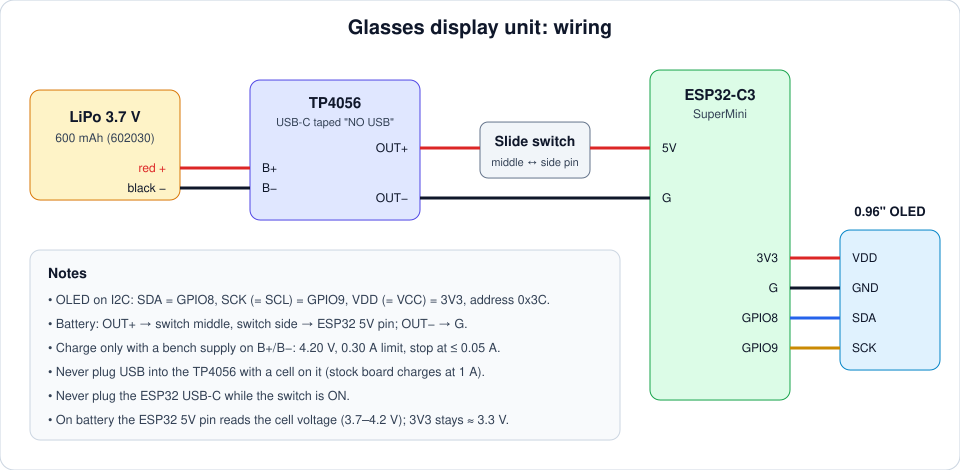

| From | To |
|---|---|
| LiPo red / black | TP4056 `B+` / `B−` (soldered, never hand-held) |
| TP4056 `OUT+` | slide switch middle pin; switch side pin → ESP32-C3 `5V` |
| TP4056 `OUT−` | ESP32-C3 `G` |
| ESP32-C3 `3V3` | OLED `VDD` (= VCC) |
| ESP32-C3 `G` | OLED `GND` |
| ESP32-C3 `GPIO8` | OLED `SDA` |
| ESP32-C3 `GPIO9` | OLED `SCK` (= SCL) |

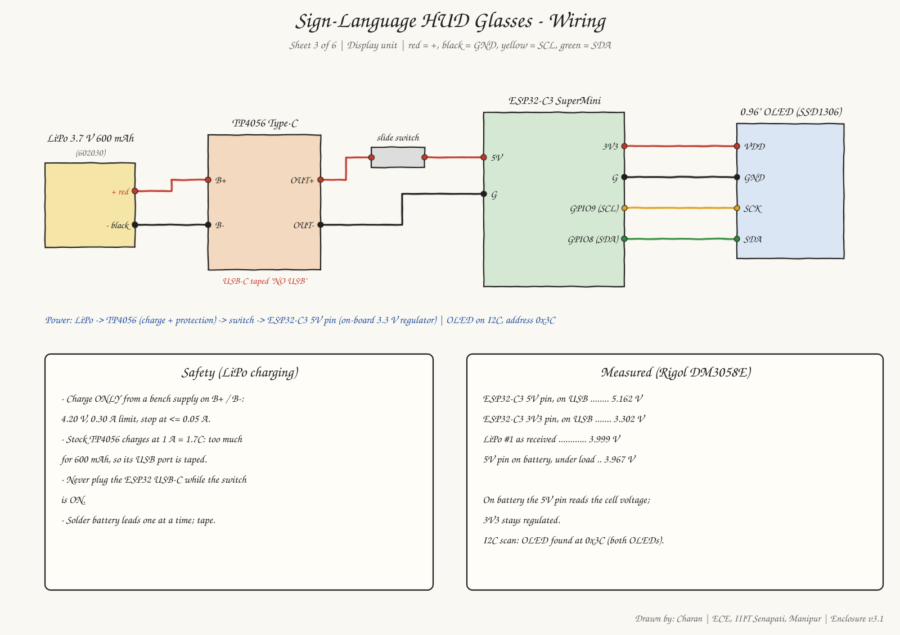

> [!WARNING]
> **Battery safety.** The stock TP4056 charges at 1 A, which is too much for a 600 mAh cell. Never plug
> USB into the TP4056 while a cell is on it: tape the port and write "NO USB". Charge only with a bench
> supply on `B+`/`B−`: **4.20 V, 0.30 A limit, stop at ≤ 0.05 A**. Never plug the ESP32 USB-C while the
> switch is ON. Full procedure: Step 8 of the [bring-up guide](docs/hardware_bringup.md).

<!-- PHOTO: breadboard wiring (ESP32-C3 + OLED) -->
<!-- PHOTO: TP4056 + LiPo + switch soldered -->

---

## 3D-printed enclosure

Parametric OpenSCAD model: [`hardware/enclosure/hud_enclosure.scad`](hardware/enclosure/hud_enclosure.scad)
(v3.1, right eye, no mirror).

- **Focus:** the OLED slides into one of 3 rail slots, at u = 19, 22 or 25 mm above the lens.
- **Pockets:** each part (LiPo, TP4056, ESP32-C3, switch) has its own pocket. The lid clicks shut and its
  fingers hold the boards down.
- **Clip-on mount:** a dovetail slot on the temple-side wall and a swappable clip that snaps onto the glasses
  arm. For other glasses, change the 5 glasses values and reprint only `clip.stl`.

| Assembly (temple side) | Inside view (lid side, lid shown see-through) |
|---|---|
|  | 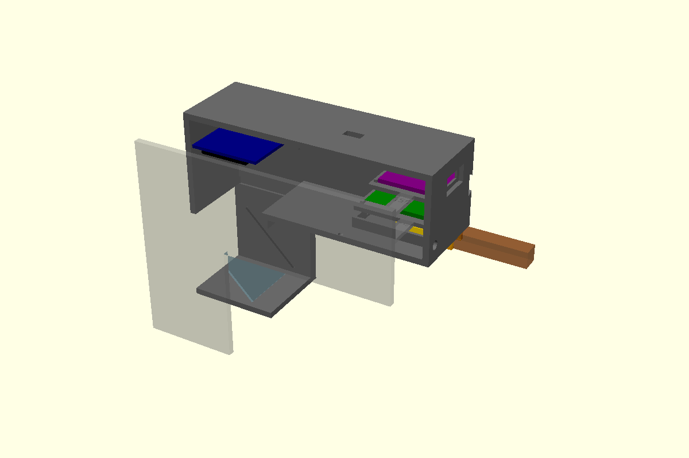 |

| Cross-section (light path: OLED → lens → 45° acrylic) | Print bed: all 4 parts (137 × 161 mm) |
|---|---|
|  | 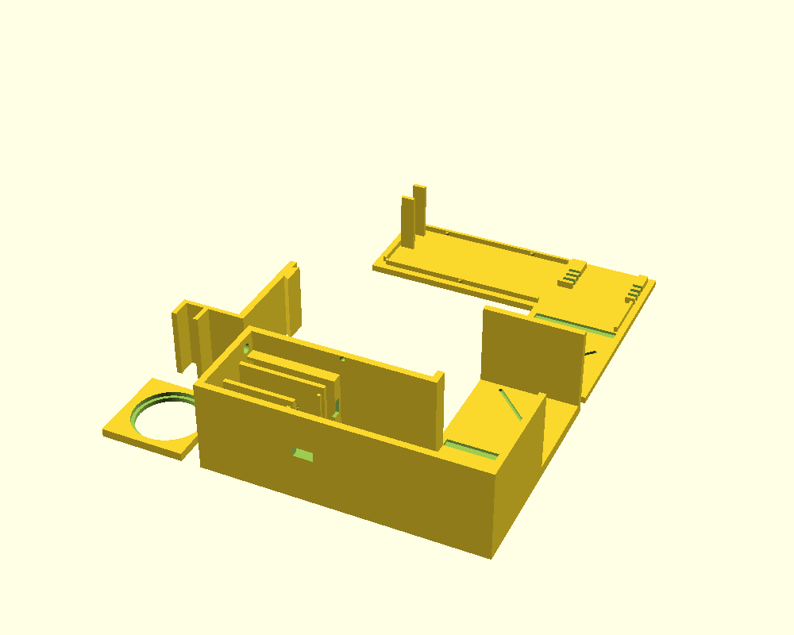 |

| Body | Lid |
|---|---|
| 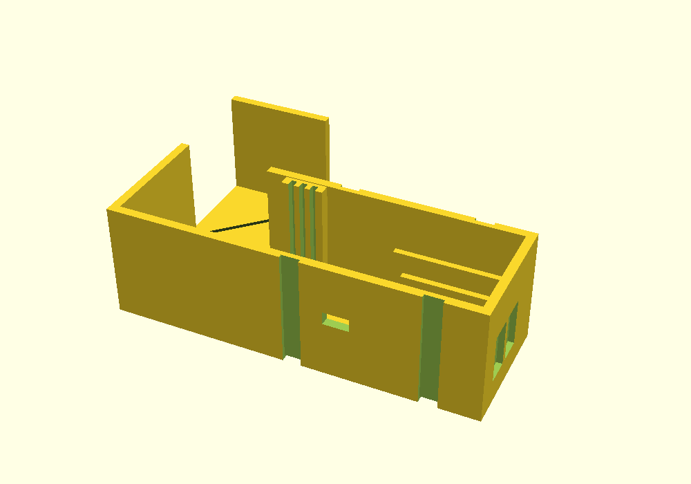 | 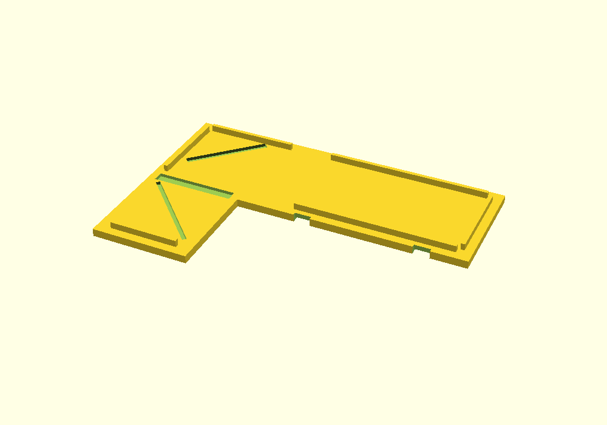 |

| Lens plate | Clip | Test-fit piece |
|---|---|---|
| 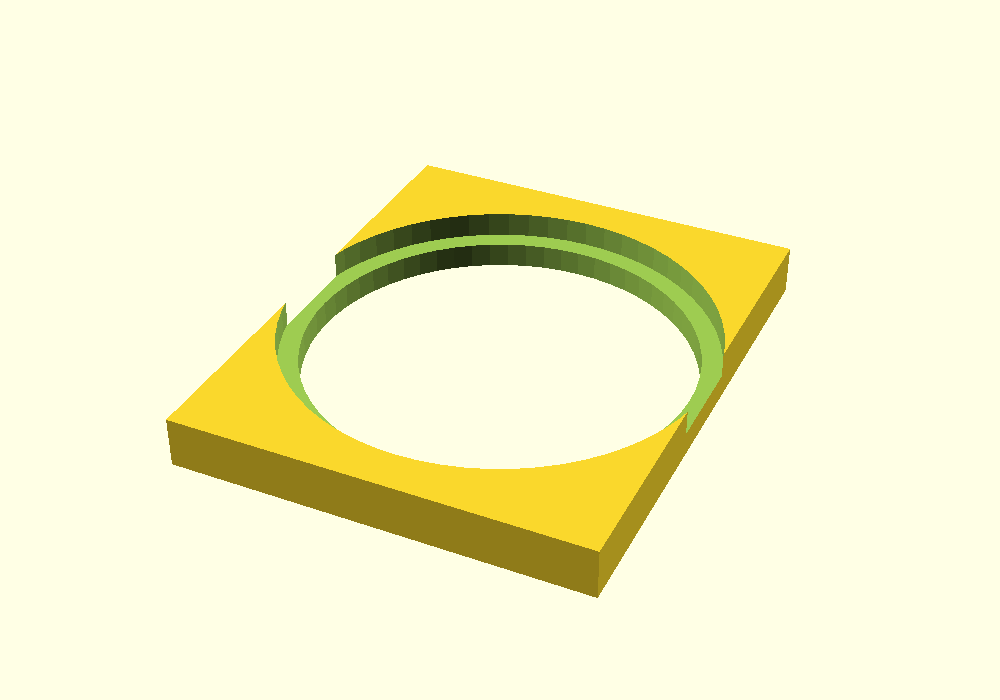 | 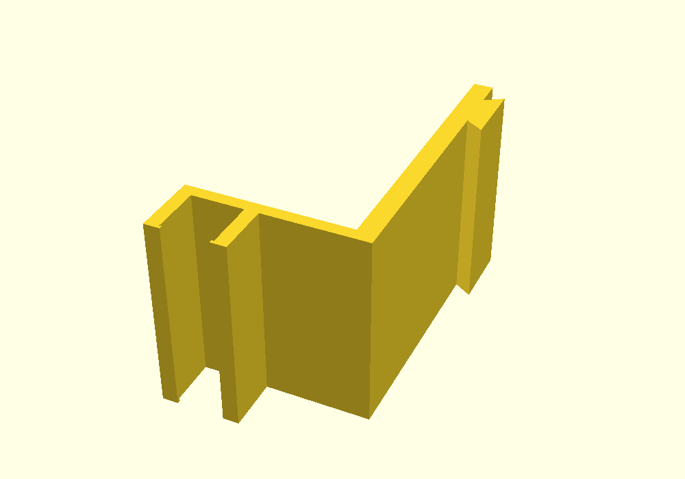 | 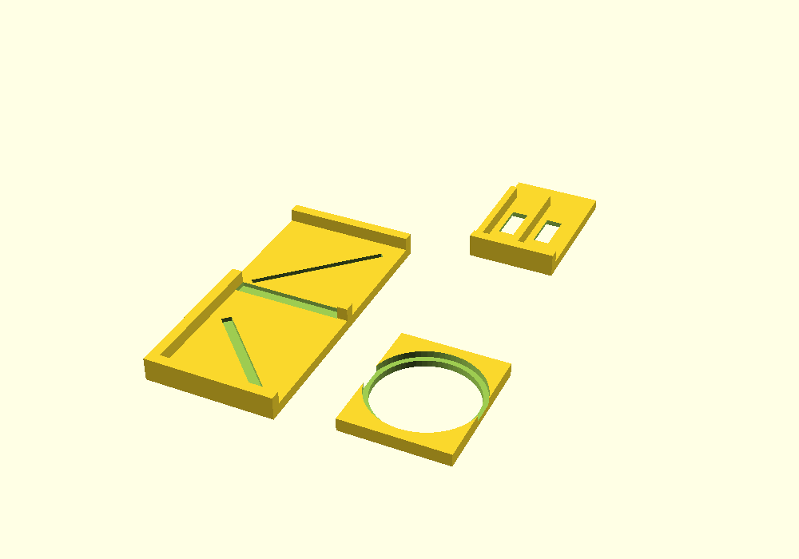 |

### Files to print

GitHub shows each STL in an interactive 3D viewer: click a file name.

| File | What | Plastic | Time (normal / fast printer) |
|---|---|---|---|
| [`print_all.stl`](hardware/enclosure/stl/print_all.stl) | all 4 parts on one bed: give this one file to the lab | ~73 g | ~6 h / ~2.5 h |
| [`body.stl`](hardware/enclosure/stl/body.stl) | temple-side wall, dovetail slot, OLED rails, pockets | 50 g | 4.2 h / 1.7 h |
| [`lid.stl`](hardware/enclosure/stl/lid.stl) | face-side wall, OLED rails, click lip, board fingers | 16 g | 1.3 h / 0.5 h |
| [`lens_plate.stl`](hardware/enclosure/stl/lens_plate.stl) | holds the 25 mm lens | 2 g | 0.1 h |
| [`clip.stl`](hardware/enclosure/stl/clip.stl) | snaps onto the 7 × 7 mm temple arm | 5 g | 0.4 h / 0.2 h |
| [`test_fit.stl`](hardware/enclosure/stl/test_fit.stl) | optional fit check: OLED slots, grooves, USB, slot + clip | 27 g | 2.2 h / 0.9 h |

**Print settings:** matte black PLA (PETG is fine too), 0.4 mm nozzle, 0.2 mm layers, 3 walls, 20 % infill,
**supports off**, parts already laid flat in the right orientation. Print `test_fit.stl` first if you are unsure
of the fits.

### Rebuild the STLs and previews

Needs [OpenSCAD](https://openscad.org/) (`brew install --cask openscad`). After changing any value in the `.scad` file:

```bash
sh hardware/enclosure/build.sh
```

The render prints the optics and clip numbers and stops with an error if any parts collide. To explore the
model, open the `.scad` file in OpenSCAD, press **F5**, then **Window → Customizer → View → `part`**
(`assembly`, `section`, `plate`, `body`, `lid`, `lens_plate`, `clip`, `test_fit`).

Assembly steps, cut list and the values still to measure:
[`hardware/enclosure/README.md`](hardware/enclosure/README.md).

<!-- PHOTO: printed enclosure parts -->
<!-- PHOTO: enclosure clipped on the glasses -->

---

## Engineering drawings

Six hand-drawn-style sheets of the current design (enclosure v3.1). Every number comes from
`hud_enclosure.scad`, its build output, the STL files or the bench measurements. Rebuild them with
`python3 docs/images/drawings/make_drawings.py`.

**Sheet 1: display unit, side view to scale.** The light path OLED → 22 mm → lens → 25 mm → 45° acrylic → eye,
the part positions and the "why these distances" maths.

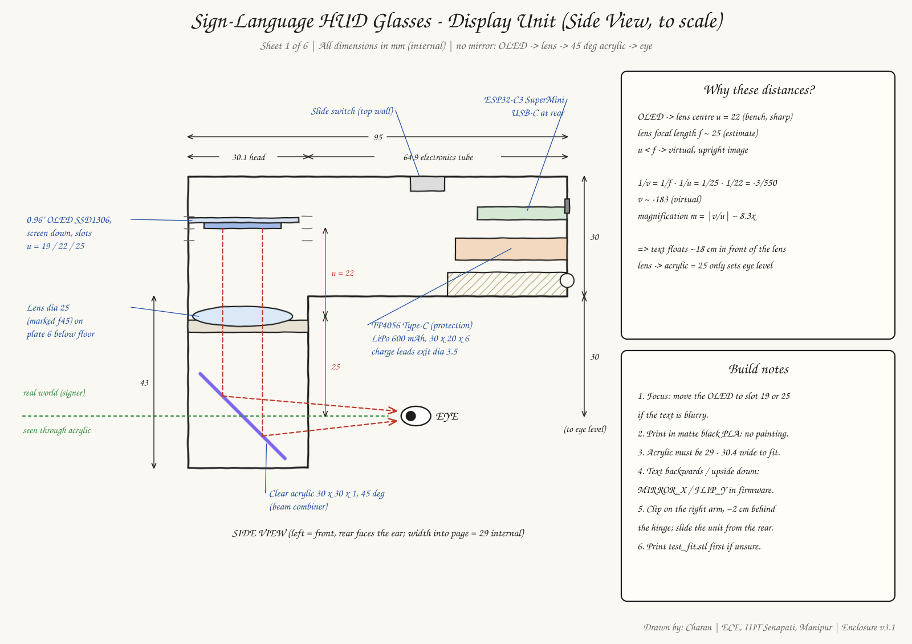

**Sheet 2: optics.** Thin-lens ray diagram with the virtual image, and the old v1 design compared with v3.1
(also shown under [How it works](#how-it-works)).

**Sheet 3: wiring.** Pin-level wiring, safety rules and measured voltages (also shown under [Wiring](#wiring)).

**Sheet 4: clip-on mount, front view.** How the clip reaches the 7 × 7 mm temple arm: dh = 37, dv = 10,
jaw_drop = 35, and the frame-rim clearance.

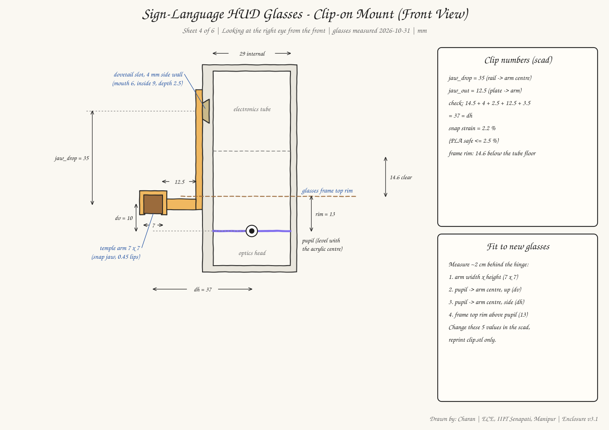

**Sheet 5: printed parts.** Outer size of each part from its STL, with mass, print time and print settings.

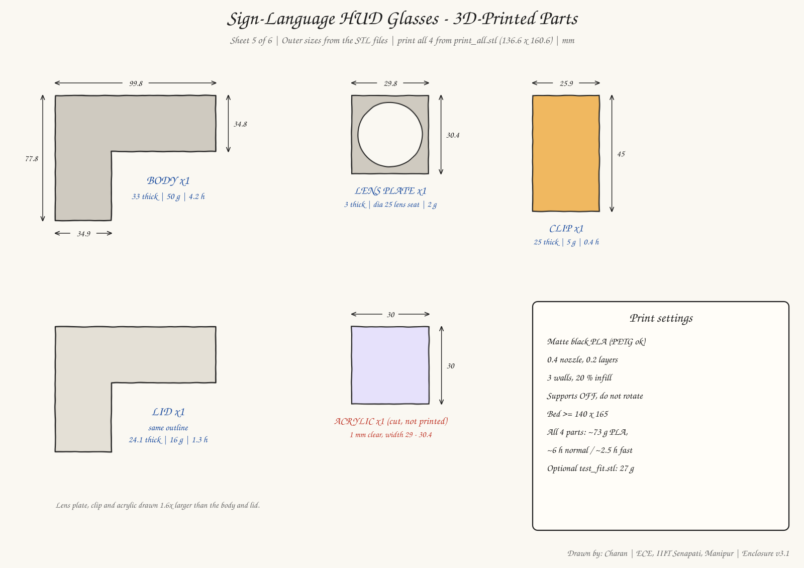

**Sheet 6: what the OLED shows.** Boot, ready, a centred word, a scrolling sentence, blank, plus the scroll timing.

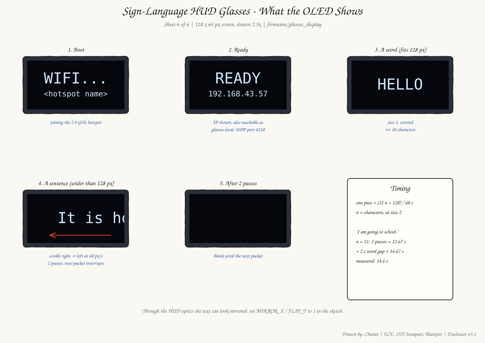

The first concept sheets (v1, superseded: mirror, u = 40 mm, foam board) are kept for reference:
[`docs/drawings/hud_glasses_drawings_v1.pdf`](docs/drawings/hud_glasses_drawings_v1.pdf).

---

## Setup, step by step

Tested on a MacBook Air (Apple Silicon, macOS). Do the steps in order: each one proves one more link of the chain.

### 1. Tools (one time)

1. **Rosetta 2** (Arduino's `ctags` is x86_64; without it the build fails with "bad CPU type in executable"):
   ```bash
   softwareupdate --install-rosetta --agree-to-license
   ```
2. **Arduino IDE 2.3** → Boards Manager → install **esp32 by Espressif Systems** (core 3.3.12 used here).
3. Library Manager → install **Adafruit SSD1306** (accept **Adafruit GFX** too).
   `WiFi`, `WiFiUdp` and `ESPmDNS` come with the ESP32 core.
4. **Python venv** at the repo root:
   ```bash
   python3 -m venv venv
   source venv/bin/activate
   pip install -r requirements.txt
   ```

### 2. Bring up the hardware

Follow the step-by-step guide (Steps 1–14) [`docs/hardware_bringup.md`](docs/hardware_bringup.md)
(printable: [`hardware_bringup.pdf`](docs/hardware_bringup.pdf)). Each step has a pass/fail check and a
test sketch in [`firmware/tests/`](firmware/tests):

| Sketch | Checks |
|---|---|
| `t1_blink` | ESP32-C3 alive: LED blinks, Serial prints `alive N` |
| `t2_i2c_scan` | OLED found on I2C at `0x3C` |
| `t3_oled_hello` | OLED shows big `HELLO` + a counter |
| `t4_wifi_udp` | Wi-Fi + UDP: text typed on the laptop appears on the OLED |
| `t5_icons` | your own image2cpp bitmap on the OLED (for fun) |
| `t6_mirror_center` | mirrored text in the centre (HUD reflection view) |

### 3. Flash the glasses firmware

1. Phone hotspot on **2.4 GHz** (the ESP32-C3 cannot join 5 GHz; on iPhone turn on **Maximize Compatibility**).
2. Wi-Fi credentials (the file is gitignored, never commit it):
   ```bash
   cp firmware/glasses_display/secrets.h.example firmware/glasses_display/secrets.h
   ```
   Then put your hotspot name and password in `WIFI_SSID` / `WIFI_PASS`.
3. Arduino IDE → **File → Open** `firmware/glasses_display/glasses_display.ino`.
4. Tools → Board **ESP32C3 Dev Module**, **USB CDC On Boot: Enabled**, Port `/dev/cu.usbmodem…` → **Upload**.
   If the upload fails: hold **BOOT**, tap **RST**, release BOOT, upload again.

Optional compile check from the terminal (uses the arduino-cli bundled with the IDE):

```bash
"/Applications/Arduino IDE.app/Contents/Resources/app/lib/backend/resources/arduino-cli" compile --fqbn esp32:esp32:esp32c3:CDCOnBoot=cdc firmware/glasses_display
```

**Pass:** the OLED shows `WIFI...`, then `READY` and the glasses' IP address.

### 4. Test the Wi-Fi link (no ML)

Join the Mac to the same hotspot:

```bash
source venv/bin/activate
python tools/send_test.py --text hello
```

**Pass:** `hello` appears on the OLED within ~0.5 s. If `glasses.local` does not resolve, use the IP shown on
the OLED: `python tools/send_test.py --host <IP> --text hello`. Leave out `--text` to type lines interactively.

### 5. Simulated signing (no camera, no model)

```bash
python software/run.py --simulate --port 9000
```

**Pass:** the words `IT`, `IS`, `HOT`, `TODAY` appear big in the centre, 2 s apart. Then `It is hot today.`
scrolls right-to-left twice, and the screen goes blank. The terminal prints
`[glasses] sending to glasses.local = <IP>:4210`. `--port 9000` is only needed if port 8000 is busy.

### 6. Live camera (real signs)

One-time install (about 1 GB: torch, mediapipe, opencv):

```bash
cd software
pip install -r requirements.txt
python download_models.py          # MediaPipe models -> software/mp_models/
python selftest.py                 # checks the install
```

Put a trained model in `software/model/` (`sign_model.pt`, or `words/` + `letters/`). Recording your own signs,
datasets (INCLUDE-50 and others) and training are covered in [`software/RUNBOOK.md`](software/RUNBOOK.md). Then:

```bash
python run.py --port 9000
```

**Pass:** sign in front of the camera: each word appears on the OLED, then the full sentence after a short pause.

Useful flags for `run.py`: `--glasses <IP>` (if `glasses.local` fails), `--no-glasses`, `--camera <n>`,
`--translate {auto,off,simple,llm}` (`llm` needs `pip install groq` and a `GROQ_API_KEY`).

---

## App ↔ glasses interface

Full contract: [`docs/interface.md`](docs/interface.md). Change it only when both sides agree.

- Both devices on the same phone hotspot. Glasses = mDNS **`glasses.local`**, **UDP port 4210**.
- One datagram per word or sentence, UTF-8 JSON, **under 256 bytes** (firmware buffer `char packet[256]`):

  ```json
  {"text": "hello", "conf": 0.92}
  ```

  | Field | Type | Meaning |
  |---|---|---|
  | `text` | string | word or short line to show |
  | `conf` | number 0–1, 2 decimals | model confidence |

- A packet that is not JSON is shown raw (handy for debugging, e.g. `echo hi | nc -u glasses.local 4210`).

## Configuration

**Link values** in [`config.yaml`](config.yaml), read by `tools/send_test.py` and `software/glasses.py`:

```yaml
network:
  glasses_host: glasses.local   # mDNS name the ESP32 registers
  udp_port: 4210                # UDP port the glasses listen on
  no_link_timeout_s: 10         # glasses show "NO LINK" after 10 s without packets
```

**Firmware switches** at the top of [`glasses_display.ino`](firmware/glasses_display/glasses_display.ino):

| Define | Default | Meaning |
|---|---|---|
| `MIRROR_X` | `0` | `1` = flip left/right (if the HUD optics mirror the text) |
| `FLIP_Y` | `0` | `1` = flip upside down |
| `SCROLL_PX_PER_S` | `60` | sentence scroll speed; must match `software/run.py` |
| `SCROLL_PASSES` | `2` | scroll the sentence this many times, then blank; must match `software/run.py` |
| `UDP_PORT` | `4210` | must match `network.udp_port` |

**Enclosure values** (optics, fits, board sizes, glasses arm) are named parameters at the top of
[`hud_enclosure.scad`](hardware/enclosure/hud_enclosure.scad). Rebuild with `build.sh` after any change.

---

## Troubleshooting

| Symptom | Fix |
|---|---|
| OLED stuck on `WIFI...` | Hotspot is 5 GHz or the password in `secrets.h` is wrong. Move closer (the SuperMini antenna is weak). |
| OLED blank | Check the SDA/SCK wires; run `firmware/tests/t2_i2c_scan` (expect `0x3C`). |
| "no I2C devices" | SDA/SCL swapped, loose jumper, or VCC on 5V by mistake. |
| Upload fails | Hold BOOT, tap RST, release BOOT, upload again. Try another cable (some are charge-only). |
| Serial Monitor prints nothing | Tools → **USB CDC On Boot: Enabled**. |
| `bad CPU type in executable` when compiling | Install Rosetta 2 (setup step 1). |
| `cannot find glasses.local yet` | Use the IP from the OLED: `python software/run.py --simulate --glasses <IP>`. |
| Nothing arrives | Mac and glasses on the same hotspot? Same port in `config.yaml` and the sketch? |
| `The HTTP server did not start` | Port 8000 is busy: add `--port 9000`. |
| `No trained model found` | Live mode needs a model; use `--simulate` until then. |
| Text backwards or upside down in the HUD | Set `MIRROR_X` / `FLIP_Y` to `1` and re-upload. |
| Text blurry through the lens | Move the OLED to the u = 19 or u = 25 slot. |
| 0 V on TP4056 `OUT` | Touch the bench supply (4.20 V, 0.3 A) to `B+`/`B−` for 2 s to wake the protection chip. |

More: [`docs/run_guide.md`](docs/run_guide.md), [`software/RUNBOOK.md`](software/RUNBOOK.md) (Part 13).

---

## Repository layout

```
├── config.yaml                 # link values: glasses_host, udp_port, no_link_timeout_s
├── requirements.txt            # pyyaml (for tools/send_test.py)
├── docs/
│   ├── interface.md            # app <-> glasses contract
│   ├── run_guide.md            # flash -> link test -> simulate -> live camera
│   ├── hardware_bringup.md/.pdf  # step-by-step bring-up guide (Steps 1–14)
│   ├── step12_measure.pdf      # optics fill-in sheet
│   ├── images/                 # README diagrams and renders
│   │   └── drawings/           # 6 engineering sheets (SVG) + make_drawings.py
│   ├── drawings/               # v1 concept sheets (PDF, superseded)
│   ├── guide/                  # HTML sources of the PDFs + build_pdf.sh
│   └── handoff/                # daily project log + project overview
├── firmware/
│   ├── glasses_display/        # final receiver sketch (secrets.h is gitignored)
│   ├── tests/t1..t6/           # bring-up test sketches
│   └── cam_stream/             # ESP32-CAM notes (stretch goal)
├── hardware/enclosure/         # OpenSCAD model, build.sh, STLs + PNG previews, print guide
├── software/                   # recognizer app: run.py, glasses.py (UDP sender), training, RUNBOOK.md
├── tools/send_test.py          # send typed text to the glasses (no ML)
└── scripts/                    # git hooks (handoff commit log)
```

## Further guides

| Guide | What |
|---|---|
| [`docs/run_guide.md`](docs/run_guide.md) | Short run guide: flash → link test → simulate → live camera |
| [`docs/hardware_bringup.md`](docs/hardware_bringup.md) · [PDF](docs/hardware_bringup.pdf) | Step-by-step hardware bring-up (Steps 1–14) with pass/fail checks and results |
| [`docs/step12_measure.pdf`](docs/step12_measure.pdf) | Optics bench fill-in sheet (values go into the `.scad` file) |
| [`hardware/enclosure/README.md`](hardware/enclosure/README.md) | Enclosure print settings, cut list, assembly |
| [`software/README.md`](software/README.md) · [`software/RUNBOOK.md`](software/RUNBOOK.md) | Recognizer app: install, record signs, datasets, training, live run |
| [`docs/handoff/`](docs/handoff/README.md) | Day-by-day project log |

## Credits

- **Hardware, firmware, optics and enclosure:** Charan ([@Charan20510](https://github.com/Charan20510)).
- **Sign-recognition software** (`software/`): written by my project partner, imported from
  [integral-830/sign-inference-bridge](https://github.com/integral-830/sign-inference-bridge).
- HUD optics concept inspired by [perseus784/June_Glasses](https://github.com/perseus784/June_Glasses)
  (concept only; the electronics here are new).
- Libraries: [Adafruit SSD1306](https://github.com/adafruit/Adafruit_SSD1306),
  [Adafruit GFX](https://github.com/adafruit/Adafruit-GFX-Library),
  [MediaPipe](https://github.com/google-ai-edge/mediapipe), [PyTorch](https://pytorch.org/),
  [OpenSCAD](https://openscad.org/).
