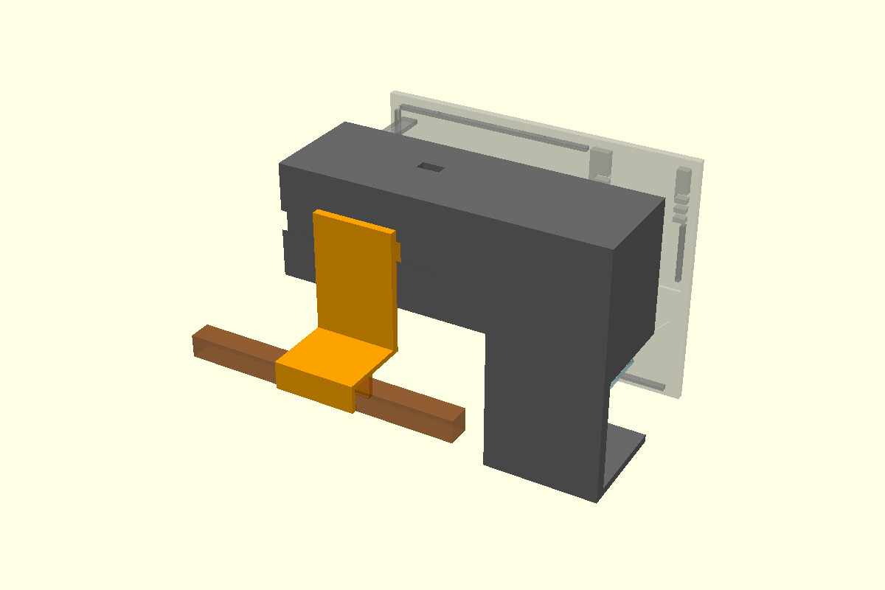
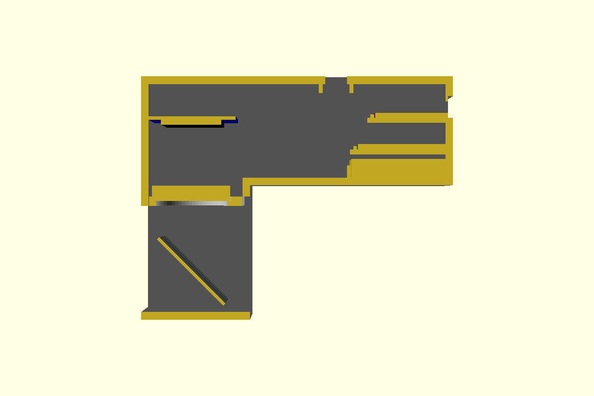

# HUD display-unit enclosure (3D print) — v3.1, ready to print

Parametric OpenSCAD model of the glasses display unit (right eye).

**Light path:** OLED (flat, screen down) → **22 mm** → lens → **25 mm** → acrylic 45° → eye. There is no mirror.

**Glasses measured (Step 12 sheet, Lenskart frame):**
- temple arm 7 × 7 mm
- arm centre 10 mm above the pupil and 37 mm to the side
- frame rim 13 mm above the pupil

**What the model does:**
- **Focus:** the OLED slides into one of 3 rail slots, at u = 19, 22 or 25 mm above the lens.
- **Pockets:** each part (LiPo, TP4056, ESP32-C3, switch) has its own pocket. The lid clicks shut and its fingers hold the boards down.
- **Clip-on mount:** a dovetail slot on the temple-side wall plus a swappable clip that snaps onto the arm. For new glasses, change the 5 glasses values and reprint `clip.stl` only.




## Files to print
| File | What | Plastic | Time (normal / fast printer) |
|---|---|---|---|
| **`stl/print_all.stl`** | **all 4 parts on one bed (137 × 161 mm)**: give this one file to the lab | **~73 g** | **~6 h / ~2.5 h** |
| `stl/body.stl` | temple-side wall, dovetail slot, OLED rails, walls, pockets | 50 g | 4.2 h / 1.7 h |
| `stl/lid.stl` | face-side wall, OLED rails, click lip, board fingers | 16 g | 1.3 h / 0.5 h |
| `stl/lens_plate.stl` | holds the 25 mm lens | 2 g | 0.1 h |
| `stl/clip.stl` | snaps onto the 7 × 7 temple arm | 5 g | 0.4 h / 0.2 h |
| `stl/test_fit.stl` | optional fit check: OLED slots, grooves, USB, TP4056 pocket, slot + clip | 27 g | 2.2 h / 0.9 h |

Plastic cost is ~₹70–100 (73 g from a 1 kg spool). The times are estimates; the slicer shows the exact time.

Rebuild after changing any value:
```bash
sh hardware/enclosure/build.sh
```
The render prints the optics, the clip numbers (`jaw_drop 35, jaw_out 12.5, strain 2.2 %`) and the frame clearance (14.6 mm). It stops with an error if anything collides.

## Print settings (tell the lab)
- **Material:** matte **black** PLA (PETG is fine too). Black inside means no stray light, so no painting.
- **Nozzle / layers:** 0.4 mm nozzle, **0.2 mm** layers.
- **Strength:** **3 walls**, **20 %** infill.
- **Supports OFF.** Don't rotate the parts: they are already laid out flat in the right orientation.
- **Bed:** at least 140 × 165 mm (any normal printer, 220 × 220). Clean the bed; use a brim only if the corners lift.
- **Check first** (optional, about 1 h on a fast printer): print `test_fit.stl` and see whether these fit:
  - the OLED in its slots
  - the acrylic and lens plate in their grooves
  - a USB-C plug in its hole
  - the clip in the slot, and on your glasses arm

  If something is tight or loose, change `clr`, `dt_clr` or `jaw_grip` and rebuild.

## How to view the whole 3D model
1. Open the **OpenSCAD** app → **File → Open** → `hardware/enclosure/hud_enclosure.scad`. Press **F5**.
2. **Window → Customizer** → **View** → `part`:
   - `assembly`: the whole unit
   - `section`: cut in half, to see inside
   - `plate`: the print bed
   - `body`, `lid`, `lens_plate`, `clip`, `test_fit`: single parts
3. Mouse: **left-drag** = rotate · **right-drag** = move · **scroll** = zoom. Toolbar: **View All**, the **±X/Y/Z** views, **Reset View**.
4. Quick look at an STL: in Finder, select it and press **Space**.

## Cut list
- Acrylic: **30 × 30 mm**, 1 mm clear. It must be 29–30.4 mm wide to sit in the side-wall grooves.

## Assembly
1. Lay the body temple-side down, open side up.
2. Lens into the lens plate; slide the plate into its groove (6 mm below the tube floor).
3. Acrylic into its 45° groove (`\`), 25 mm below the lens.
4. **OLED:**
   - Bend the header pins flat toward the rear, or solder the wires straight onto the pads (there is 3.5 mm of room above the board).
   - Screen **down**, pins at the **rear**: slide it into the **middle** slot (u = 22).
5. **Boards:**
   - LiPo into the floor cradle.
   - TP4056 into the lower pocket, with its charge pigtail out through the Ø3.5 rear hole (tie a knot inside).
   - ESP32-C3 into the upper pocket, with USB-C in the rear cut-out.
   - Switch into its frame under the top slot.
6. Run the wires through the gap on the lid side.
7. Press the lid on until it clicks.
8. **Mount on the glasses:**
   1. Snap the clip onto the right temple arm, about 2 cm behind the hinge.
   2. Slide the unit's slot onto the clip from the rear.
   3. Slide it forward or back until the text sits in front of your eye.
9. Switch on and check:
   - Blurry: move the OLED to slot 19 or 25.
   - Text backwards or upside down: change `MIRROR_X` or the rotation in firmware.

## Things to know
- **Values measured:**
  - optics: u = 22, acrylic at 25
  - glasses: 7 × 7 arm, dv 10, dh 37, rim 13
- **Values not measured yet** (they still carry a `MEASURE` comment in the file):
  - board sizes
  - where the OLED glass starts and ends (`oled_glass_x`)
  - lens thickness

  The pockets have 0.3 mm of clearance, so small errors are fine. Print `test_fit` first if you're unsure.
- **Eye position:** the pupil sits level with the acrylic centre, 30 mm below the tube floor. The glasses frame rim stays 14.6 mm clear of the tube.
- **Eye distance:** the glasses lens sits just behind the head's back face. Slide the unit on the clip to set the distance.
- **Clip snap strain** is 2.2 %, under PLA's ~2.5 % limit. Snap it on gently. PETG is more forgiving.
- **The lens:** it focuses at u = 22, so its real focal length is likely ~25 mm, not the marked 45.
- **Changes from v2:**
  - no mirror (the `mirror_order` sheet is obsolete)
  - zip-tie grooves off (`tie_grooves_on = false`)
